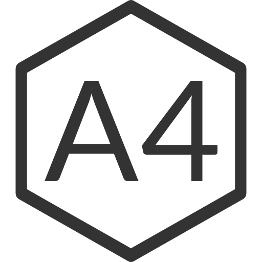
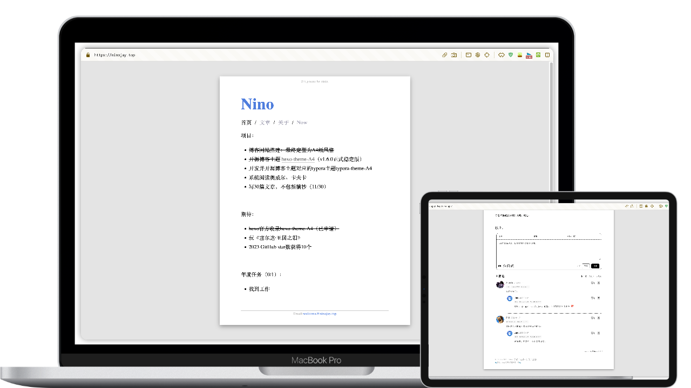
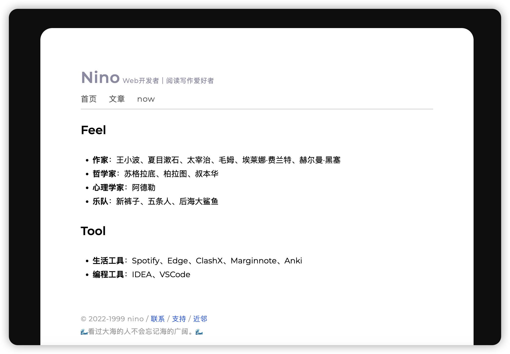
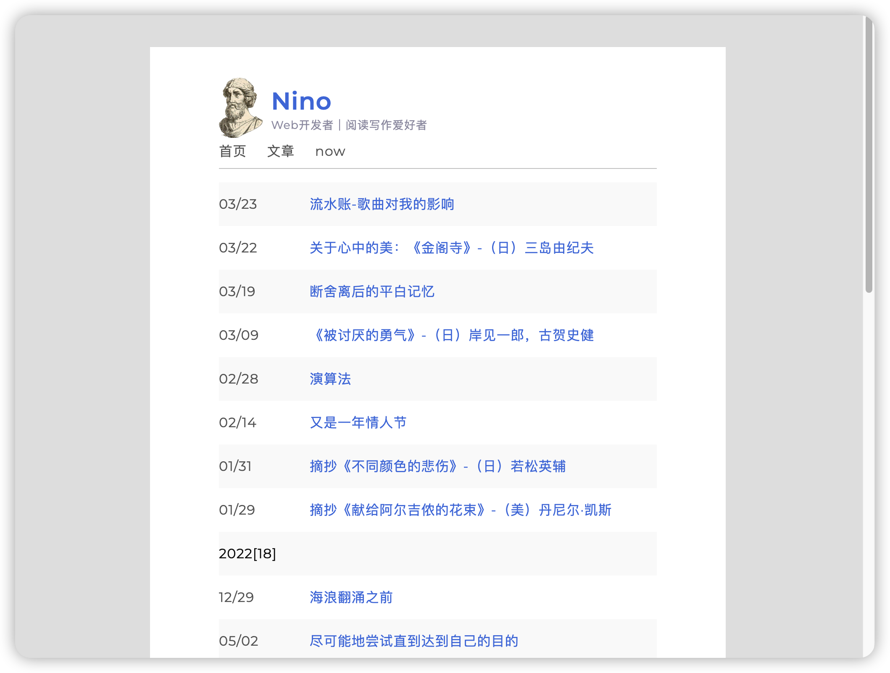
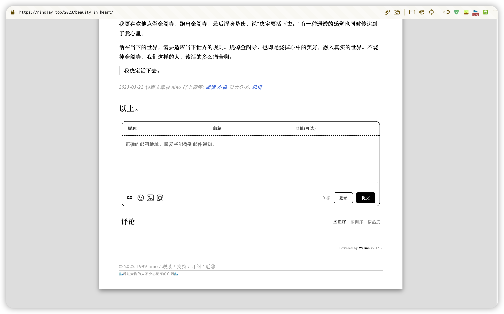
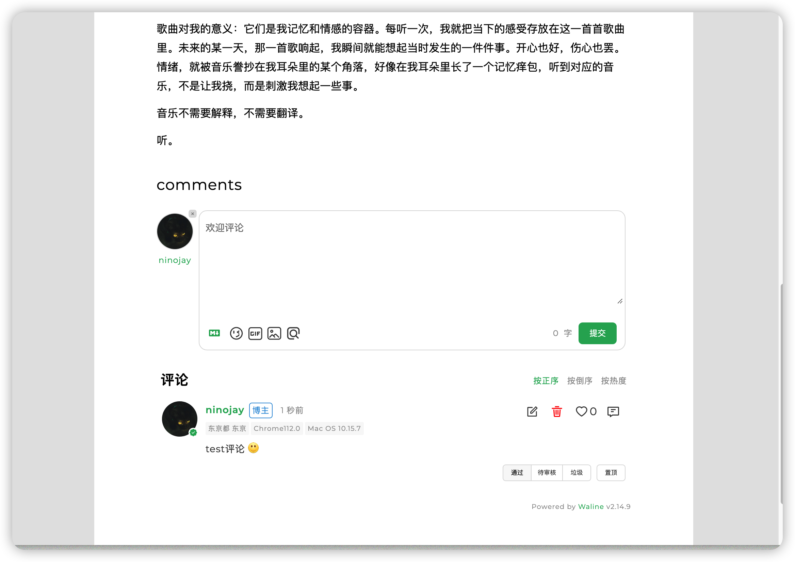

# hexo-theme-A4

<div align="right">
  <a title="zh-CN" href="https://github.com/HiNinoJay/hexo-theme-A4"> </a>
  <a title="EN" href="README-EN.md">  </a>
  <a title="zh-TW" href="README_zh-TW.md"></a>
</div>

<div align="center" >
<a href="https://ninojay.top">

</a>
</div>

<div align="center">

模仿A4紙張的一個hexo極簡主題。主打一個簡潔，體積小，配置少。


[]()
[](https://hexo.io/zh-cn/index.html)
[](https://nodejs.org/en)

「讓讀者專注於閱讀文字，作者專注於寫作。」➡️ [效果展示](https://ninojay.top) ➡️ [使用文檔](https://doc.ninojay.top)

_右上角一個star，更快更新功能_

</div>


[](https://github.com/HiNinoJay/hexo-theme-A4)

## 🏹️特點

- [x] 博客網站基本功能：歸檔/標籤/分類/目錄
- [x] 首頁簡歷化，word化，內容自定義化
- [x] 頁面的頁腳頁眉自定義
- [x] 文章可單獨配置：隱藏文章、開關評論、開關目錄、文章置頂、[數學公式支持](https://ninojay.top/hexoplugin/hexo-filter-mathjax/)、[文章加密訪問](https://ninojay.top/hexoplugin/hexo-blog-encrypt/)
- [x] [**全局色調可自定義配置，預覽多種配色**](https://ninojay.top/hexoplugin/A4-color-change/)
- [x] 採用最美評論模塊waline
- [x] 預置md可使用的css樣式
- [x] 自帶CDN加速國內訪問速度
- [x] [可壓縮圖片/css/js資源大幅度提升網站訪問速度](https://ninojay.top/hexoplugin/hexo-all-minifier/)
- [x] [詳細的使用文檔](https://doc.ninojay.top)
- [x] [經過作者驗證可支持的hexo插件](https://ninojay.top/tags/hexoPlugin/)
  - [x] [mathjax 數學公式](https://ninojay.top/hexoplugin/hexo-filter-mathjax/)
  - [x] [encrypt 特定文章加密訪問](https://ninojay.top/hexoplugin/hexo-blog-encrypt/)
  - [x] [github-emojis 語法支持](https://ninojay.top/hexoplugin/hexo-filter-github-emojis/) 
  - [x] [reference 腳標支持](https://ninojay.top/hexoplugin/hexo-reference/) 
  - [x] [minifier 壓縮網站圖片/css/js等資源](https://ninojay.top/hexoplugin/hexo-all-minifier/) 

## 🔥效果展示

### 多種主題配色

#### 灰白配色（默認）


#### 綠金配色（已預置｜可一鍵啟用）


`顏色搭配是一門學問`，除A4推薦的兩種配色外，你可以自行調色，並把顏色方案分享給大家。更多配色請看：[預覽](https://ninojay.top/hexoplugin/A4-color-change/)。

### 首頁



### 文章列表



### 文章標籤和分類信息



### 評論




## 👋如何使用

- 確認已通過命令`hexo init`創建好了文件夾,這裡舉例你的文件夾名為`website`
- `命令行`進入到`website`文件夾路徑下
- 將`website`文件夾下的`_config.yml`文件中將主題設置為A4
- 接下來正式安裝`a4主題`，有兩種方式,任選其一

### npm方式（推薦）
- 執行命令 `npm install hexo-theme-a4@latest`
- 在`website`文件夾路徑下創建`_config.a4.yml`文件，將[這裡的內容](https://github.com/HiNinoJay/hexo-theme-A4/blob/main/_config.yml)複製進去
- 對主題的所有個性化配置都將在`_config.a4.yml`文件中進行，可按照文件中的註釋自行配置
- 執行命令：`hexo s` 運行項目查看效果

### git方式
- 執行命令：`git clone git@github.com:HiNinoJay/hexo-theme-A4.git themes/A4`
- 在`website`文件夾路徑下創建`_config.a4.yml`文件，將[這裡的內容](https://github.com/HiNinoJay/hexo-theme-A4/blob/main/_config.yml) 複製進去
- 對主題的所有個性化配置都將在`_config.a4.yml`文件中進行，可按照文件中的註釋自行配置
- 執行命令：`hexo s` 運行項目查看效果

## ⚠️必讀配置

首頁（index）和文章列表頁（list）會在啟動時（`hexo g` / `hexo s`）自動建立，無需手動執行命令。如需自訂首頁內容，直接編輯 `source/index/index.md` 即可。

其他詳細配置請看：
➡️ [使用文檔](https://doc.ninojay.top)，已上線。

## ⬆️如何更新
根據你`安裝`的方式，選擇`對應的`更新方式。

### npm方式
命令行進入到你的博客網站`根目錄`下
執行命令：
```shell
npm install hexo-theme-a4@latest
```

### git方式

命令行進入到`themes/A4`目錄下
執行命令:

```shell
git pull
```
---

### 注意

以上兩種方式更新後，請去該[github頁面](https://github.com/HiNinoJay/hexo-theme-A4/releases)查看最新的版本，作者會告訴配置文件有無新增/修改。

如果有，則需要複製最新的[該文件](https://github.com/HiNinoJay/hexo-theme-A4/blob/main/_config.yml)對應到你的`_config.a4.yml`新增/修改的部分。

## ☕️支持

歡迎提交 pull request 或 issue，請提交至dev分支。

其他任何想交流的事，可發送郵件至：welcome@ninojay.top

如果覺得我做的不錯，請給該專案一個star，或者[請我喝杯咖啡☕️](https://ninojay.top/supportbymoney/)

## 💗感謝

由衷感謝A4支持者們：https://github.com/HiNinoJay/hexo-theme-A4/blob/main/DONATION.md

## Stargazers over time

[](https://starchart.cc/HiNinoJay/hexo-theme-A4)
